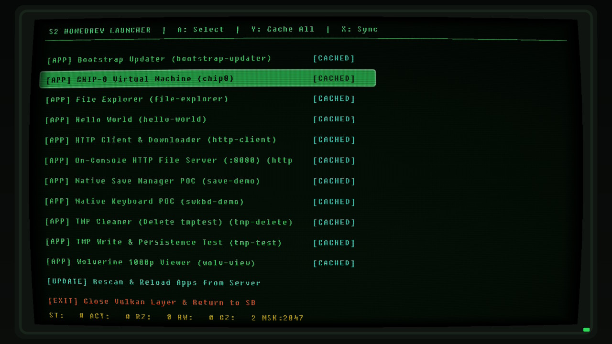

# SpecialOctoLauncher

A cross-platform host & GPU-driven homebrew runtime and a comprehensive suite of **Proof of Concept (POC)** applications for **S2** via **SmileBASIC 4.4.9** (`HOS 23.0.1`), featuring an interactive **Homebrew Launcher**, **Autonomous Offline App Caching**, **Filesystem Explorer**, **On-Console HTTP File Server (`:8080`)**, **`tmp:/` Cache & Persistence Tools**, and a comprehensive **official-aligned `nn::*` GLSL SDK**—all without requiring a Raspberry Pi Pico keyboard server.



> **Research & Validation Notice:**  
> This project is a curated series of **Proof of Concept (POC)** examples built to explore, stress-test, and validate what is technically achievable on the S2 platform. It demonstrates how homebrew applications can leverage Vulkan 1.4 hardware rendering overlays, autonomous 60 FPS native worker threads, direct OS applet invocations (`nn::swkbd`), atomic save data commits, and local memory swapping to run independently of a PC.
>
> ⚠️ **Status Note:** Offline mode is currently a **work in progress** and is not working yet. Running applications currently requires an active PC host connection (`node server.js`).

---

## ⚠️ Risk Warning

**Running homebrew software, custom native code execution, and memory RPC tools on proprietary console hardware carries inherent risks.** Improper usage, incorrect memory writes, network configuration issues, or incompatible firmware states can cause system instability, crashes, system freezes, or unresponsiveness.

We (Main developer and contributors) are not responsible for any damage to your S2, PC, or other hardware; data loss; corrupted saves; or any other consequences arising from the use of this software. Always back up important data before making modifications. This software is provided as-is, without warranties of any kind. Use at your own risk and discretion.

---

## Overview & Architecture

- **Supported Environment:** Proven and validated exclusively on **HOS 23.0.1** and **SmileBASIC 4.4.9**.
- **Platform Compatibility:** Developed on **Windows**, with cross-platform support for **macOS** and **Linux**.
- **System Architecture:**
  - **Console-Side Autonomous 60 FPS Loop:** Runs an independent `nn::vi::Layer` + Vulkan 1.4 swapchain (`1920×1080`) driven by a native `pthread` executing a repeating call frame on the S2. Gamepad, Pro Controller, and touch polling (`nn::hid`) alongside compute and fragment shader rendering run at full 60 FPS directly on hardware.
  - **Host-Side RPC Bridge & On-Demand App Loader:** The PC host (`server.js` + `runtime/hello-runner.cjs`) qualifies the native session, prepares Vulkan pipelines **on-demand** when apps are selected, and services asynchronous SDK mailbox requests (`nn::fs`, `nn::socket`, `nn::nifm`, `nn::hid`, `nn::time`, `nn::os`, `nn::irsensor`, `nn::nfc`, `nn::audio`).
  - **Offline Memory Staging & Local Dispatcher:** Apps can be pre-cached into S2 cache storage (`tmp:/cache/`) and GPU coherent memory slots (`mapped + 0x300000 + slot * 0x40000`). When the PC server disconnects, SmileBASIC transitions into an autonomous `LOCAL_DISPATCHER` loop that swaps 512-byte command descriptors, font atlases, and scratch states in ~5 microseconds via native `SDK_MEMMOVE`—enabling seamless offline play and swapping without a PC connection.

---

## Included Proof of Concept Applications (`apps/`)

By default, `node server.js` boots into the **Homebrew Launcher** (`apps/launcher`), where you can launch any compiled app on demand, cache apps locally (`Y`), rescan the catalog live (`X`), and scroll through the catalog with the D-Pad.

> **Navigation Rule:** Across all applications, **`-` (MINUS)** is reserved universally as the **Exit / Back** button returning you directly to the Homebrew Launcher. (The Launcher itself stays running on the hardware overlay, as tearing down the Vulkan swapchain to return to SmileBASIC 4 is unsupported by the platform).

| App ID | Name | Description & Controls |
| --- | --- | --- |
| `launcher` | **Homebrew Launcher** | Smoothly scrolling CRT tube app picker with vertical scrollbar indicator, animated progress modal, live server catalog update (`X` or `[UPDATE]`), and offline local caching (`Y: Cache All`). (`D-Pad`: Scroll, `A`: Launch, `X`: Rescan). |
| `pong` | **Joy-Con Pong** | Retro arcade Pong featuring Joy-Con HD Rumble haptics on paddle hits, wall bounces, and goals. Features realistic spin physics, digital 7-segment scoreboard, match celebration, and intelligent AI opponent. (`D-Pad / L-Stick`: Left paddle, `X / B`: Right paddle, `X`: Toggle AI, `+`: Reset, `-`: Exit). |
| `touch-waves` | **Touch Waves** | Interactive multi-touch ripple & wave interference visualizer supporting up to 16 simultaneous touch points with glowing finger reticles, live touch coordinate readouts, central shockwaves, and 4 color themes. (`Touch / Drag`: Create Waves, `X`: Cycle Palette, `Y`: Shockwave, `A`: Clear, `-`: Exit). |
| `rumble-lab` | **HD Rumble Lab** | Interactive Joy-Con Linear Resonant Actuator haptics test bench with isolated Left/Right motor firing, custom duration/amplitude tuning, 5 haptic presets (Click, Heartbeat, Burst, Boom), and real-time dual oscilloscope audio waveform visualizer. (`A`: Left Motor, `B`: Right Motor, `Y`: Dual Stereo, `X`: Preset, `D-Pad`: Tune, `-`: Exit). |
| `nono-feed` | **Nonopost Social** | Live anonymous decentralized social feed client powered by the Nonopost API (`https://api.nonopost.com`). Features S2 native software keyboard (`nn::swkbd`) post composition, multi-card scrollable feed with author badges and timestamps, star rating submission (`A`: 10★, `R`: 5★), and Joy-Con HD Rumble feedback. (`D-Pad / Stick`: Scroll, `Y`: New Post, `X`: Refresh, `A`: 10★, `R`: 5★, `-`: Exit). |
| `order-rush` | **Order Rush** | Prototype 2D top-down courier delivery game (barely works / extremely badly vibecoded POC). Gather apples & sticks from groves, manage inventory bag limits, fulfill customer counter orders before patience expires, and score high-speed bonuses with Joy-Con HD Rumble haptics. (`D-Pad / Stick`: Move, `A`: Pick / Deliver, `-`: Exit). |
| `hello-world` | **Hello World** | Interactive Joy-Con controller visualizer displaying real-time button states, analog stick coordinates, and handheld/detached controller configurations at 60 FPS autonomously. (`-`: Exit). |
| `file-explorer` | **File Explorer** | Read-only S2 filesystem browser across `rom:/`, `save:/`, `tmp:/`, and virtual `exefs:/` (loaded process modules & sections). Features 15-entry 2-column directory pages and a 20-line `.TXT`/`.PRG`/`T*` viewer with automatic SmileBASIC 4 container header stripping and `zlib` decompression. (`A`: Open/Read, `B`: Parent/Close File, `D-Pad`: Navigate/Scroll, `-`: Exit). |
| `http-server` | **On-Console HTTP File Server (`:8080`)** | Binds a listening TCP socket (`nn::socket`) directly on the S2's LAN IP (`http://<s2-ip>:8080/`). Open the URL on any PC or phone browser to browse `rom:/`, `save:/`, `tmp:/`, and `exefs:/`, preview decompressed files or hex dumps, and download console files directly over Wi-Fi. (`X`: Restart Socket, `-`: Exit). |
| `http-client` | **HTTP Client & Downloader** | Outbound HTTP `GET` queries and file streaming directly into console storage (`tmp:/download.bin`) using official-aligned `nn::http` abstractions. (`A`: GET /get, `X`: GET /ip, `Y`: Download robots.txt, `-`: Exit). |
| `swkbd-demo` | **Native Soft Keyboard POC** | Direct on-console integration with the S2 Native Software Keyboard (`nn::swkbd`), invoking the OS library applet for real-time text input into a glowing CRT terminal display. (`A`: Open Keyboard, `X`: Clear Text, `-`: Exit). |
| `web-browser` | **Native Web Browser Applet POC** | Seamless integration with the S2 Native Web Browser Applet (`nn::web::ShowWebPage`). Features custom URL editing via `nn::swkbd`, 6 curated web bookmarks, interactive CRT tube omnibox UI, and return result code toast inspection. (`A`: Open in Browser Applet, `Y`: Edit URL, `D-Pad`: Select Bookmark, `-`: Exit). |
| `web-cruiser` | **Web Cruiser & Flag Explorer** | Extended browser applet runner with user-configurable `ShowWebPageArg` parameter toggles. Allows testing standard and internal flags before launching (`X`: Toggle Flag 0x2BC, `L`: Toggle Touch, `R`: Toggle Pointer, `A`: Launch, `Y`: Edit URL, `-`: Exit). |
| `audio-lab` | **Audio Lab & Soundboard** | Hardware audio playback test bench powered by native `nn::audio`. Features 8 retro sound effects (Coin, Laser, Jump, Explosion, Powerup, Hit, 1-Up, Beep), procedural tone synthesizer (Sine, Square, Triangle, Saw, Noise), real-time CRT phosphor oscilloscope visualizer, dual VU meters, and Joy-Con HD Rumble haptic pairing. (`A/B/X/Y/L/R`: Fire SFX, `+`: Mode, `D-Pad`: Tune / Vol, `-`: Exit). |
| `save-demo` | **Native Save Manager & Commit POC** | Tests raw file operations on the `save:/` mount (`save:/f/###/TTEST`), demonstrating atomic `nn::fs::CommitSaveData` transactions directly on console storage. (`A`: Save & Commit, `Y`: Verify, `X`: Clean, `-`: Exit). |
| `bootstrap-updater` | **Bootstrap Updater & Committer** | Live on-console updater that reads the latest repository `rpc/bootstrap.bas` from the PC host, injects SmileBASIC trailing padding, writes to `save:/f/###/TNS2` (`TXT:NS2`), and commits to S2 save data. (`A`: Update & Commit, `-`: Exit). |
| `chip8` | **CHIP-8 Virtual Machine** | On-console compute-shader interpreter running ROM programs directly from `tmp:/rom.ch8` at 60 FPS on the GPU. Features retro CRT bloom, 4 selectable phosphor palettes, Joy-Con controls, and HD rumble sound buzzer (`nnHidSendVibrationPulse`). (`A`: Reload tmp:/rom.ch8, `X`: Palette, `Y`: Speed, `+`: Reset, `-`: Exit). |
| `wolv-view` | **Wolverine 1080p Viewer** | Downloads a 1920×1080 PNG image live from a remote web server via `nnHttpDownloadImage` and renders it edge-to-edge fullscreen on the S2. (`A`: Reload, `X`: Toggle HUD, `-`: Exit). |
| `tmp-test` | **TMP Write & Persistence Test** | Verifies `nn::fs::GetEntryType` and `nn::fs::CreateFile` on SmileBASIC's `tmp:/` (`MountCacheStorage`) mount by checking and creating `tmp:/tmptest` and reporting persistence across runs. (`A`: Re-check, `X`: Delete & Recreate, `-`: Exit). |
| `tmp-delete` | **TMP Cleaner (`Delete tmptest`)** | Built using pure shader-side `nnFsGetEntryType` + `nnFsDeleteFile` SDK primitives to check for `tmp:/tmptest` and remove it if present. (`A`: Re-check & Delete, `-`: Exit). |

---

## Offline Autonomous Caching Engine (Work in Progress)

> [!WARNING]
> **Work in Progress:** Offline mode and autonomous app transitions without the PC server are currently under active development and **not working yet**. An active PC connection (`node server.js`) is currently required to launch and cycle applications. The memory staging mechanisms and local dispatcher outlined below represent the architectural implementation currently in progress.

SpecialOctoLauncher provides an on-console caching system that allows running and launching apps without maintaining an active PC connection:

1. **Staging to `tmp:/` & GPU Memory (`Y: Cache All`):**
   - Pressing **`Y`** in the Launcher prompts the host to stage up to 15 apps in 256 KiB coherent memory blocks (`mapped + 0x300000 + slot * 0x40000`).
   - Each slot packages:
     - 512-byte pre-built Vulkan command buffer descriptors (`slotMapped + 0`)
     - Initial scratch states with ready flags (`slotMapped + 0x200`)
     - Preserved directory entries for the Launcher (`slotMapped + 0x300`)
     - Fixedsys font atlas slices (`slotMapped + 0x800`)
   - Simultaneously writes backup binary packages to S2 storage: `tmp:/cache/<appId>-state.bin` and `tmp:/cache/<appId>-data.bin`.
   - Populates a 64-bit aligned `AppTable` at `scratch + 0x7d000` (`APPS` magic `0x41505053`).
   - Emits a bitmask to `mapped + 992` (`c.stats.x`), instantly displaying bright `[CACHED]` badges next to all staged applications.

2. **Autonomous Dispatcher (`LOCAL_DISPATCHER`):**
   - When `node server.js` is disconnected, SmileBASIC detects the `APPS` magic and transfers execution to `LOCAL_DISPATCHER`.
   - Transitions between the Launcher and any cached app execute via native `SDK_MEMMOVE` in ~5 microseconds without needing PC intervention.
   - Pressing `-` inside any running application returns instantly to the Launcher offline.

---

## Official-Aligned GLSL SDK (`sdk/include/hb.glsl`)

All apps have unrestricted access to the native SDK mailbox (`mapped + 0x7f0000`). Functions in [`sdk/include/hb.glsl`](sdk/include/hb.glsl) mirror official S2 SDK (`nn::*`) conventions:

### 1. `nn::fs` — Filesystem Suite (`OP.fs = 9`)
- **Path & Payload Staging:** `nnFsSetPathByte(i, ch)`, `nnFsSetSecondPathByte(i, ch)`, `nnFsSetWriteByte(i, val)`
- **File & Directory Primitives:**
  - `nnFsGetEntryType(pathLen)` → `nnFsResultExists()`, `nnFsResultEntryType()`, `nnFsResultFileSize()`, `nnFsResultCode()`
  - `nnFsCreateFile(initialSize, pathLen)` / `nnFsDeleteFile(pathLen)` / `nnFsRenameFile(oldLen, newLen)`
  - `nnFsReadFile(offset, maxBytes, pathLen)` → `nnFsResultBytesTransferred()`, `nnFsResultByte(i)`
  - `nnFsWriteFile(offset, dataLen, pathLen)` (auto-creates/resizes, writes, flushes, and closes)
  - `nnFsCreateDirectory(pathLen)` / `nnFsDeleteDirectory(pathLen)` / `nnFsRenameDirectory(oldLen, newLen)`
  - `nnFsCommitSaveData(mountLen)`
- **High-Level Helpers:** `nnFsReadDirectory(maxEntries, startOffset, pathLen)`, `nnFsReadTextLines(lineStart, pathLen)`

### 2. `nn::socket`, `nn::nifm` & `nn::http` — Networking (`OP.net = 10`, `OP.udp = 3`)
- **Interface Status:** `nnNifmGetCurrentPrimaryIpAddress()` → `nnNifmResultIpAddress()`, `nnNifmResultConnectionStatus()`
- **TCP Server & Client:**
  - `nnSocketListenTcp(port, backlog)` → `nnSocketResultFd()`
  - `nnSocketAccept(listenFd, timeoutMs)` → `nnSocketResultFd()`, `nnSocketResultReady()`
  - `nnSocketConnect(ipv4BigEndian, port)` → `nnSocketResultFd()`
  - `nnSocketRecv(fd, maxBytes, timeoutMs)` → `nnSocketResultBytes()`, `nnSocketResultReady()`, `nnSocketResultByte(i)`
  - `nnSocketSetSendByte(i, val)` + `nnSocketSend(fd, byteLen)`
  - `nnSocketClose(fd)`, `nnSocketGetSockName(fd)`, `nnSocketGetLastErrno()`
- **UDP Datagram Exchange:** `nnSocketSendToUdpEndpoint(endpoint, bytes)`
- **HTTP / HTTPS Outbound Client (`nn::http`):**
  - **Staging Helpers:** `nnHttpSetUrlByte(i, ch)`, `nnHttpSetPostByte(i, val)`, `nnHttpSetSavePathByte(i, ch)`
  - **Requests:** `nnHttpGet(maxBytes, urlLen)` / `nnHttpPost(postLen, urlLen)`
  - **Direct File Downloads:** `nnHttpDownloadTo(savePathLen, urlLen)` / `nnHttpDownloadToTmp(urlLen)`
  - **Live Image Downloads & Decode:** `nnHttpDownloadImage(urlLen)` (downloads PNG image, decodes to raw RGBA, and uploads directly into GPU storage memory for fullscreen rendering)
  - **Response Accessors:** `nnHttpResultStatusCode()`, `nnHttpResultTotalBytes()`, `nnHttpResultBodyBytes()`, `nnHttpResultErrno()`, `nnHttpResultBodyByte(i)`, `nnHttpImageWidth()`, `nnHttpImageHeight()`

### 3. `nn::hid` — Controllers, IMU & Haptics
- **Input Polling:** `nnHidGetNpadButtons()`, `nnHidGetNpadPressed()`, `nnHidGetNpadSourceButtons(slot)`, `nnHidGetAnalogStick(right)`, `nnHidGetTouchScreenCount()`, `nnHidGetTouchScreenPoint(i)`, `nnHidGetKeyboardKey(usage)`, `nnHidGetMousePosition()`, `nnHidGetMouseButtons()`
- **6-Axis IMU:** `nnHidGetSixAxisSensorCount()`, `nnHidGetSixAxisAcceleration(i)`, `nnHidGetSixAxisGyroscope(i)`, `nnHidGetSixAxisDirection(i)`
- **Hardware Metadata & Haptics:** `nnHidGetNpadBodyColor()`, `nnHidGetNpadButtonColor()`, `nnHidGetPlayerLedPattern()`, `nnHidIsVibrationPermitted()`, `nnHidGetNpadControllerInfo(npadId)`, `nnHidSendVibrationPulse(...)`, `nnHidSendVibrationPattern(...)`

### 4. `nn::time`, `nn::os`, `nn::swkbd` & System Info
- **Soft Keyboard Applet:** `nnSwkbdShow(...)` (launches native OS keyboard modal)
- **Clocks & System Info:** `nnTimeStandardSteadyClockNow()` (64-bit ARM `CNTPCT_EL0` tick, `19.2 MHz` frequency, POSIX seconds, and calendar fields), `nnOsGetSystemInfo()` (process `aruid`, steady tick, thread priority, `main`/`sdk` module bases)
- **Peripherals:** `nnIrSensorGetCameraStatus(npadId)`, `nnNfcScanTag()`, `nnAudioListAudioIns(maxCount)`

### 5. `nn::web` — Web Browser Applet (`OP.web = 14`)
- **Documentation:** See [`docs/web-applet.md`](docs/web-applet.md) for full architectural documentation, symbol resolution details, and native calling conventions.
- **URL Staging:** `nnWebSetUrlByte(i, ch)`, `hbWebUrlByte(i, ch)`
- **Browser Execution:** `nnWebShowWebPage(urlLen)` / `hbWebShow(urlLen)` (constructs `nn::web::ShowWebPageArg`, sets display parameters, and launches the native web applet modal synchronously)
- **Status & Results:** `nnWebGetResult()` (exit status code, `0 = SUCCESS`), `nnWebGetExitReason()` (reason descriptor, `0 = USER_EXIT`)

---

## Prerequisites & Dependencies

1. **Node.js (v22+)** — Runs `server.js`, the TCP RPC listener, and the host runtime.
2. **Python 3 + Pillow (`PIL`)** — Used by `assets.py` to generate Fixedsys glyph atlases (`text.bin`) and icons (`server.js` verifies and installs Pillow automatically if missing).
3. **Vulkan SDK (`glslangValidator` & `spirv-val`)** — Used when compiling app shaders via `sdk/build.cjs`.
4. **Network Access** — Inbound TCP port **39380** must be open through your PC firewall.

---

## Getting Started

1. **Start the Host Server on your PC:**
   ```bash
   node server.js [host-ip]
   ```
   *(Optional flags: `--app=<app-id>` to boot directly into a specific app instead of `launcher`, `--verbose` for low-level RPC transfer logs).*

2. **Configure your PC IP in `bootstrap.bas` (Required for the `I` shortcut):**
   > [!IMPORTANT]
   > The convenient `I` shortcut command at the bottom of [`rpc/bootstrap.bas`](rpc/bootstrap.bas#L464-L467) contains a hardcoded IP address:
   > ```basic
   > COMMON DEF I
   >  VAR V
   >  V=START(39380,10,0,0,2)
   > END
   > ```
   > **You MUST change `10,0,0,2` on line 466 to your computer's actual local IPv4 address** (e.g., `192,168,1,50` if your PC is `192.168.1.50`).  
   > If you do not update this line, typing `I` will attempt to connect to `10.0.0.2` and halt with `BOOT FAILED 58` (Connect failed / host unreachable).

3. **Connect from SmileBASIC on your S2:**
   ```basic
   LOAD "TXT:NS2"
   RUN
   I
   ```
   *(Or if you prefer not to edit `bootstrap.bas`, run the manual command printed by `server.js`:)*
   ```basic
   REMOVE NSR,&H60000000,&H3FFFFFFF
   V=START(39380,192,168,1,50)
   ```

4. **Offline Play (Without PC Server):**
   - While connected, press **`Y`** in the Launcher to cache all apps.
   - Stop `server.js` on PC (`Ctrl+C`).
   - The S2 console will transition to `LOCAL_DISPATCHER` (`ST: 10`).
   - Select any cached app and press `A` to launch completely offline!
   - Press `-` to return to the Launcher anytime.

4. **Compiling / Creating New Apps:**
   - Shaders can be compiled manually with `sdk/build.cjs`:
     ```powershell
     python apps/<app-id>/assets.py
     node sdk/build.cjs apps/<app-id>
     ```
   - Press **`X`** in the Launcher on S2 to rescan the catalog live without restarting the server.

---

## Credits & Acknowledgements

- [HBLauncher by ravensclawx](https://github.com/ravensclawx/HBLauncher) — Homebrew launcher architecture and GPU rendering pipeline.
- [ns2jb by pepsipu](https://gitlab.com/pepsipu/ns2jb/-/tree/main?ref_type=heads) — Initial deployment code, bootstrap script, RPC foundations, and Hello World app structure.
